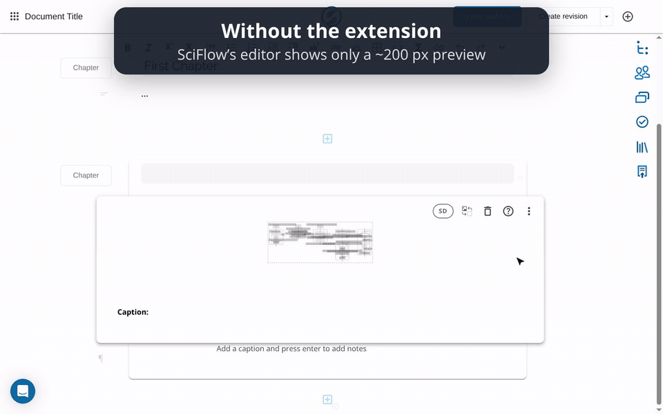

# SciFlow Sharp Figures

A small Chrome/Chromium extension that shows the **original, full-resolution images** inside figure blocks in the [SciFlow](https://sciflow.net) editor, instead of the ~200 px previews the editor normally displays.

## Features

- **Sharp figures while you write.** Each figure shows the file you uploaded, not the low-resolution preview.
- **HD / SD toggle** in each figure's toolbar (top right). Switch back to SciFlow's own preview at any time.
- **Drag to resize.** In HD mode, drag the left/right edge or the bottom-right corner of an image. Double-click a handle to reset. Sizes are remembered per figure in your browser.
- **New and replaced images** switch to HD automatically, usually within a few seconds.
- **Display only.** Your document, its figure settings and the export are never modified.

## Install

1. Download or clone this repository.
2. Unzip it if it has been downloaded as a zip.
3. Open `chrome://extensions` and switch on **Developer mode**.
4. Click **Load unpacked** and select this folder.
5. Open (or reload) a document on `app.sciflow.net`.

## How it works

SciFlow's editor renders each figure from a small JPEG preview stored in the document. The app's own `WatchDocument` GraphQL query returns the list of uploaded files (`document.files { id url }`), where each file `id` matches the figure's `data-id`. The extension reads those responses as the page receives them and points each figure's `` at the original file. If a figure appears whose original isn't known yet (for example, one you just uploaded), it re-sends that same query to get the updated file list.

Everything runs in the page; nothing is sent anywhere except the SciFlow requests the app itself makes.

## Files

| File | Purpose |
| --- | --- |
| `manifest.json` | Manifest V3, content script on `https://app.sciflow.net/*` |
| `main.js` | Collects original file URLs, swaps images, HD/SD toggle, resize handles |
| `style.css` | Lifts SciFlow's 512×280 px preview cap, styles the toggle and handles |
| `demo/` | `demo.gif` (README), `demo.mp4` (higher quality) |

Not affiliated with SciFlow.
